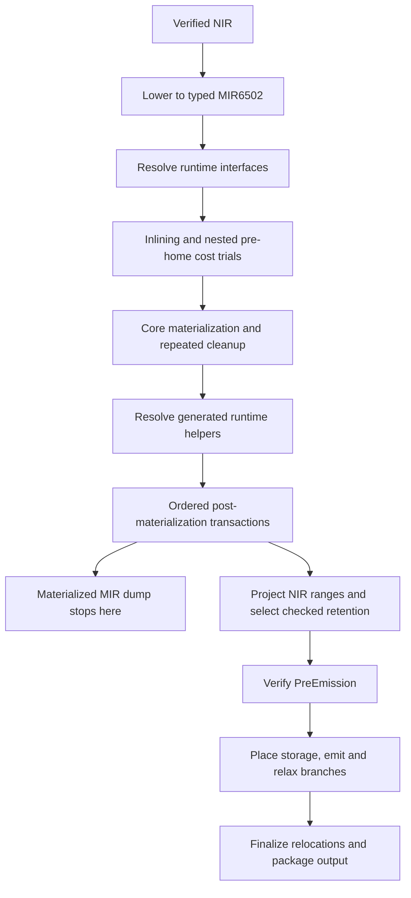

# MIR6502 optimization pipeline audit

Audited on 2026-11-13 against `c00f37a84b8c0943c81565723420ace2c0d4f8d2`.

This is a source audit of the production MIR6502 path, including its shared
NIR input and tracked emitter. It records the implemented schedule, rather
than a proposed replacement pipeline. Classic 6502, MIR65816 and MIR68K are
outside its scope. No compiler behavior changes accompany this document.

The backend has substantial shared analysis and checked rewrite machinery.
The architectural pressure is in the coordination above that machinery:
representation changes, cleanup, interprocedural summaries, physical placement
and profitability have several overlapping schedules. Within materialization,
there is no single boundary after which both optimization and placement stay
fixed; that requires completion of the executable-output path.

Read alongside the [pseudo-machine contract](MIR6502_PSEUDO_MACHINE_CONTRACT.md)
and the completed [rewrite workflow plan](MIR6502_REWRITE_WORKFLOW_PLAN.md).
Those documents define intended invariants; the source links below identify
their current implementation. Line anchors refer to the audited revision.

## 1. Production path and diagnostic endpoints

Both the compiler API's `compile_mir6502` and the CLI's code-output path lower
SemIR to NIR and run `nir::optimize_program` before MIR lowering. The modern
profile selects `Mir6502Config::optimized()`; other profiles select `default()`.
Default still enables optimization. Neither the default configuration nor
switching off one feature is a raw, optimization-free reference compiler.

The public backend `generate_output_with_config_and_runtime` accepts NIR and
verifies it through `lower_program`; it does not itself run the NIR optimizer.
Direct callers can therefore provide verified but unoptimized NIR.

Sources: [compiler entry](../src/compiler/mod.rs#L550),
[CLI entry](../src/cli.rs#L740), [configuration](../src/mir6502/passes.rs),
[verified handoff](../src/backend.rs).

The straight arrows show the accepted-program path. Cost trials repeatedly
invoke downstream materialization and/or emission before accepting that path.
The tables show scheduling order; feature switches, eligibility and proof/cost
gates determine which transformations actually apply.

| Stage | Actual work and boundary |
| --- | --- |
| NIR optimization | Verified scalar/CFG optimization; aggregate forwarding, storage propagation, scalar promotion and home elision; dependent storage/value cleanup where aggregate captures require it. No target homes or registers. |
| MIR lowering | Creates target widths, operations, ABI declarations, routine frames, typed storage identities and machine effects from verified NIR. |
| Interface resolution | Records staging eligibility and the optional inline census; resolves external runtime entries to absolute targets or linked routines; verifies pre-materialization MIR again. |
| Pre-home strategy trials | Inlining surrounds the nested cost gates listed below. Candidates are expressed before generic expansion; baseline and trial are materialized and emitted for cost/proof checks. |
| Core materialization | Expands operations, assigns value homes, runs post-home cleanup, colors storage, chooses late machine/CFG forms, verifies `PostHome`, and resolves virtual address-consumer pairs. |
| Helper resolution | Verifies `PostMaterialization`, then resolves generated/runtime helpers, which can append helper routines and link dependencies. |
| Late transactions | Applies the ordered table in section 5 to the completed materialized program. Most require unchanged frames and compare emitted costs. |
| Checked-range retention | Executable-output path projects verified NIR ranges onto matching materialized calls and performs one more costed pointer-retention transaction when eligible. |
| Final emission | Verifies `PreEmission`; computes object placement and branch relaxation; uses tracked instruction emission; finalizes relocations and constructs the runtime-specific load file/map. |

Sources: [NIR schedule](../src/nir.rs#L80),
[MIR orchestration](../src/mir6502/mod.rs#L127),
[executable-output tail](../src/mir6502/mod.rs#L331),
[helper resolution](../src/mir6502/runtime.rs#L34).

**Diagnostic mismatch:** `--emit-materialized-mir6502` calls
`materialize_program_with_origin_and_runtime` and verifies/prints its result.
It does not execute the subsequent range projection and checked-retention
transaction in `generate_output_with_config_and_runtime`. It also precedes
tracked emitter optimizations. Its output is a useful intermediate artifact,
but is not necessarily the exact MIR used for the generated executable.
See the [CLI dump path](../src/cli.rs#L676).

### Nested cost gates before core materialization

The implemented nesting, from outermost to innermost, is:

1. Small-leaf/requested inlining, when enabled.
2. Captured-bound loop motion.
3. Bounded comparison-loop pointers, with optional comparison fusion/Y induction.
4. Call-predicate argument forwarding and optional predicate ABI selection.
5. Indexed address-value selection.
6. Small-copy value forwarding; accepted forwarding can try constructor store
   elision, home elision and payload forwarding.
7. Scalar argument-capture/pattern-binding forwarding and storage elision.
8. Captured-byte comparison selection.
9. Core materialization, post-materialization verification and helper resolution.

These are not nine inexpensive sequential peepholes. A gate can materialize
its baseline and candidate through the remaining inner gates, repair a partial
selection, or replay the chosen source for reporting. The inliner retains
materialized baselines while trying groups against the original higher-level
representation. Candidate prefilters and local trial limits bound individual
features; this audit does not establish aggregate compilation cost.

Sources: [nested dispatch](../src/mir6502/mod.rs#L208),
[inliner](../src/mir6502/materialize/inlining.rs#L472),
[copy/constructor gate](../src/mir6502/materialize/copy_values.rs#L21),
[scalar-capture gate](../src/mir6502/materialize/scalar_captures.rs#L36).

## 2. Where values acquire memory homes

There are several distinct events. Allocating an object, choosing a value's
carrier, and fixing its physical address must not be treated as one decision.

| Event | Implemented representation | What is still undecided |
| --- | --- | --- |
| Source storage and semantic captures | NIR already contains globals, persistent locals, parameters, argument captures, pattern bindings and aggregate captures. These are explicit storage objects, not backend spills. NIR promotion/elision can remove proven private objects. | Target carrier and object address. |
| MIR lowering | Surviving params/locals become `MirStorageSlot`s in `MirFrame`; absolute locals lower to absolute accesses rather than ordinary frame allocation. Purpose, size, scalar width, initialization and alias backing survive. `frame.spills` initially starts empty. | Ordinary frame addresses and which remaining virtual temps need spills. |
| ABI entry capture | `prepend_action_abi_param_prologue` inserts copies from incoming ABI locations into parameter homes, or uses the larger-argument capture path. | Later parameter forwarding/coalescing/elision can remove some captures or allocations. |
| Block-argument lowering | Parallel edge copies become explicit moves, sometimes with split edges and fresh temps. Exclusive sources may coalesce. A merge temp may now have definitions in several predecessor blocks. | Register versus memory home for these temps. |
| Operation/call expansion | Byte/word operations, address consumers and call staging become more concrete. Calls receive byte ABI operands; logical call result bindings become explicit result moves/loads. Some consumers already receive values directly in registers or destination storage. | Homes of residual temp lanes. |
| Home census and register plan | After pre-home cleanup, `record_home_demand_census` classifies lane demands. `apply_register_home_plan` substitutes admitted producer/consumer ranges with register carriers. | Unhandled lanes take the generic spill path. This is selective home avoidance, not a whole-routine register allocator. |
| Generic temp materialization | `materialize_temp_ops_with_routine_widths_and_address_reuse` turns residual temp definitions/uses into register work plus spill stores/loads. The initial lane identity is `MirSpillId(2 * temp_id + byte)`. Boolean branches and address definitions are also made explicit. | Spill reuse, zero-page promotion and physical placement. |
| Coloring and home elision | Basic-block and routine coloring merge noninterfering spill IDs. Unreferenced spills are pruned. Selected spills move into virtual/reused zero page. Narrow ABI passes can coalesce a word param with its result home or mark an unread param `ParamAbiOnly`. | Addresses of ordinary objects; final code-dependent deferred placement. |
| Emission placement | `MirObjectLayout` assigns ordinary storage and resolves symbolic addresses. | Nothing for that successfully finalized program/origin/runtime snapshot; a later transformation requires a new placement. |

Sources: [NIR local purposes](../src/nir/lowerer.rs#L400),
[MIR frame creation](../src/mir6502/lower.rs#L757),
[ABI capture/elision](../src/mir6502/materialize/abi.rs#L15),
[edge copies](../src/mir6502/materialize/block_args.rs#L15),
[call expansion](../src/mir6502/materialize/calls.rs#L3819),
[home planning](../src/mir6502/materialize/home_census.rs#L541),
[temp materialization](../src/mir6502/materialize/temps.rs#L609),
[spill identity](../src/mir6502/materialize/temps.rs#L1340),
[coloring](../src/mir6502/materialize/spills.rs#L1905).

Two consequences matter when interpreting assembly:

- An Action! local/parameter home can remain observable even if its current
  value is available in A/X/Y. Removing a reload, removing its earlier store,
  and removing the storage allocation require different proofs.
- After coloring, a spill ID is a reusable storage identity. Dividing it by
  two no longer recovers a unique original value. Post-home reasoning uses
  reaching store definitions and byte locations; `HomeFateTracker` separately
  follows remaps for diagnostics.

`prune_unused_spills` only removes declarations with no remaining references.
A store-only spill still counts as referenced. It is not a dead-store pass.
See [pruning](../src/mir6502/materialize/spills.rs#L1209).

## 3. Core materialization: the actual cleanup schedule

The body of `materialize_program_with_reporting` is the central schedule.
The following sequence includes the transitions that change the meaning of
available facts, rather than listing every instruction-selection recognizer.

| Order | Operation group | Analysis/cleanup consequence |
| --- | --- | --- |
| C1 | Select tiny fills; expand large aggregate copies; refine terminal indirect-jump effects; reserve pointer scratch and allocate existing virtual zero page; insert ABI prologues; build `MaterializeLayout`. | CFG/effects/storage demand can change before general routine analyses. Initial layout is a planning view. |
| C2 | Select aggregate copies; clean temp artifacts and lower block arguments; narrow discarded high lanes; reduce constant multiply/divmod and selected shifts. | Changes definitions and lane demand before home selection. |
| C3 | Pre-home canonicalization: dynamic word-index loops, optional small-loop unrolling, compare producer/narrowing/direct-compare selection, compare branch/value expansion, predicate ABI selection, further edge-copy lowering, empty-jump collapse. | CFG/dominance/use-def facts must be rebuilt. Abstract comparison identity gives way to explicit flags/blocks. |
| C4 | Pre-home consumer selection: address values, carry-chain stores, pointer/copy/index consumers, argument producers, return-slot/result forwarding, store expressions and unused address removal. | Tries to avoid staging before residual values become memory traffic. Individual analyzed families run their own fixed points. |
| C5 | Expand remaining address computations and operations; normalize byte-high forms; expand word compares; run bounded pre-home cleanup. | Producer/consumer shapes change again. Cleanup recomputes temp liveness; its outer limit is eight rounds. |
| C6 | Build home demand/plan; apply register ranges; materialize remaining temp and Boolean homes; make address writes explicit; promote selected induction/address spills. | Logical temp analyses stop being the appropriate authority for the rewritten operations. |
| C7 | First post-home structural group, then cleanup/coloring, without whole-program known-callee summaries. | Uses home definitions, register/flag liveness and conservative call behavior. |
| C8 | Coalesce selected leaf word parameters with result homes; elide write-only params; declare required helpers; allocate new virtual zero-page slots. | Frame/ABI identities and physical scratch writes change. |
| C9 | Build known-callee summaries and a fresh planning layout; repeat post-home structural and cleanup groups, now with callee information and terminator materialization. | Cross-call facts expose opportunities unavailable at C7. Cleanup also removes dead spill stores and recolors/prunes spills. |
| C10 | Rerun write-only-param elision; optional dead arithmetic/private memory shifts; promote block-local byte spills; allocate zero page; rebuild summaries; reuse preserved zero-page pairs for selected call results. | Last broad home-selection/remapping stage in the core. |
| C11 | Rebuild summaries/layout; rerun SSA-lite byte cleanup and exact Z/N zero-compare folding; select shift/XOR diamonds, direct INC/DEC updates, register loop carriers, block layout and counted-loop latches. | The code explicitly accounts for coloring exposing equivalent physical bytes and compare cleanup exposing update/branch forms. CFG and machine facts change. |
| C12 | Materialize remaining pointer-cell values; fold redundant register reloads; coalesce/hoist selected shift/XOR stores; collapse/reorder affected blocks. | Can expose new dead register writes and private stores. |
| C13 | Run analyzed dead-register-write cleanup, then analyzed dead-private-scratch-store cleanup, then prune unused spills. Verify `PostHome`; resolve virtual address-consumer pairs; record home fates/statistics. | There is late cleanup. It is not a fixed point over all prior groups and does not run after all later transactions or emission. |

Sources: [C1–C10](../src/mir6502/materialize.rs#L1364),
[C11–C13](../src/mir6502/materialize.rs#L1649),
[canonicalization](../src/mir6502/materialize.rs#L2665),
[consumer selection](../src/mir6502/materialize.rs#L2833),
[pre-home cleanup](../src/mir6502/materialize.rs#L4157).

The repeated post-home structural group includes parameter reload and spill
forwarding, direct updates, staged-word forwarding, indirect/indexed memory
forms, known-callee result/index carriers, SSA-lite rewrites, dead private
stores and dead register writes. Its subsequent cleanup group handles
redundant address setup, SSA-lite cleanup, result placement, dead register
writes, dead spill stores, spill coloring and pruning.

Sources: [structural group](../src/mir6502/materialize.rs#L2962),
[cleanup group](../src/mir6502/materialize.rs#L3097).

These are ordered groups containing family-local fixed points. The source
does not establish a global post-home normal form in which rerunning every
group would make no change. For example, C13 runs dead-register cleanup before
dead-store cleanup; removing a store can make its producer newly dead, without
another dead-register cleanup at that boundary.

## 4. Which facts survive transitions

| Transition | Preserved or explicitly translated | Retired, weakened or reconstructed |
| --- | --- | --- |
| Verified NIR → MIR | Routine/storage identities, normalized control/data operations, storage sizes/backing/aliases/purposes, scalar widths/signatures, signedness where needed, callable ABI/effects, static data/relocations and machine effects. | NIR analysis objects are not passed wholesale into MIR. High-level types become target-relevant widths/forms; storage, dominance and range facts are recomputed or projected by dedicated consumers. No SemIR lookup is used to recover them. |
| Interface resolution/inlining/CFG rewrites | Typed targets, explicit actual values, storage identities and declared effects. Inlining creates fresh IDs and explicit entry/continuation dataflow. | Old op indices, CFG, dominance, reaching definitions, liveness and call census assumptions are tied to their original snapshot. |
| Pre-home rewrite rounds | Exact temp/lane definitions, uses, dominance, liveness, memory effects and selected machine obligations are available in a shared immutable snapshot. | The driver drops/rebuilds the snapshot after an accepted batch. A proof is not a permanent permission attached to an operation. |
| Byte/ABI/home expansion | Byte lanes, explicit carry dependencies, exact memory operands, selected register/fixed-slot arguments, result copies and call effects. | Original expressions and logical call-result bindings disappear from executable operations. Later analyses must infer available values from explicit instructions/homes. |
| Post-home analysis | Reaching home definitions, home liveness, A/X/Y and flag liveness, param/register availability, known-callee facts; machine-value identities for constants/direct/indexed memory and exact Z/N provenance. | This is not a general symbolic evaluator. In particular, `MirMachineValueState` has no general carry-value lattice derived from branch edges. |
| Spill coloring/ZP remapping | Explicit memory uses/defs are remapped together; frame allocations and diagnostic home-fate maps are updated. | Pre-remap home identity, interference and physical-equality facts are invalid. C11 deliberately rebuilds machine facts after remapping. |
| Completed materialization → late transactions | Explicit instructions, frames, fixed pairs, ABI/effects and newly analyzed callee summaries. | Earlier temporary snapshots are gone. Late proofs build current analyses; placement-sensitive ones obtain an emitted physical map. |
| NIR range projection → checked retention | Immutable NIR range receipts are associated with specific completed MIR calls, coherent word ABI lanes and storage homes. | Projection requires matching CFG/call correspondence and unique admitted user-call associations. Changed/unsupported shapes lose this optimization rather than guessing a mapping. |
| MIR → emitted bytes | Typed storage/routine references become addresses/relocations; routine/block ranges remain available for internal cost/proof consumers. Output maps retain storage/routine/debug metadata. | MIR operation identities and home-def graphs are not a byte-level optimization IR. Tracked emitter state is rebuilt from emitted instructions and cleared at labels/barriers. |

Sources: [IR structures](../src/mir6502/ir.rs),
[pre-home snapshot](../src/mir6502/analysis/prehome.rs),
[post-home snapshot](../src/mir6502/analysis/posthome.rs),
[machine values](../src/mir6502/analysis/machine_values.rs#L13),
[range projection](../src/mir6502/analysis/address_ranges.rs#L47),
[rewrite driver](../src/mir6502/rewrite/driver.rs#L334).

The verifier phases are predicates over the same `MirProgram` type, not four
different IR types or a strictly increasing ordering of guarantees:

| Verification phase | Relevant guarantee and limitation |
| --- | --- |
| `PreMaterialization` | Allows typed virtual computation, block arguments and abstract conditions; validates identities, operation forms, ABI and effects. |
| `PostHome` | Rejects virtual temps in ordinary executable definitions/operands and checks selected private pointer definitions before virtual consumers are resolved. It does not mean ordinary RAM addresses are final. Certain condition-producer forms still have dedicated validation. |
| `PostMaterialization` | Rejects remaining block arguments and various unexpanded forms, but its virtual-temp rule is weaker than `PostHome`. Core materialization has already checked `PostHome` before the outer function invokes this check. |
| `PreEmission` | Requires emission-ready operations/conditions, physical value homes and resolved helper targets, with selected address forms validated. Symbolic relocatable storage references still require emission layout. |

The [verifier's phase predicates](../src/mir6502/verify.rs#L49) and
[virtual-temp regression](../src/mir6502/verify.rs#L4171) make this distinction
explicit. None of these checks certifies that optimization is exhausted or
that a previous placement-dependent proof survives a later transformation.

There are several legitimate kinds of value knowledge, with different scopes:

- Pre-home temp identity answers which logical definition a consumer uses.
- SSA-lite home equalities track copies among admitted frame bytes; the
  `home_values` precision layer canonicalizes aliases and invalidates both
  destination and source dependencies of an equality on overlapping writes.
- Routine machine-value analysis tracks what A/X/Y and selected fixed slots
  contain across CFG edges, meeting only facts agreed by predecessors.
- Known-callee summaries describe reads/writes, preserved registers/pairs and
  selected incidental exit values or entry flag requirements.
- Tracked emission maintains local processor state while instructions are
  written; it does not inherit the MIR analysis snapshot.

These should not automatically become one universal analysis. The audit issue
is ownership and transfer: which layer is authoritative for a claim, which
mutation invalidates it, and how the next layer re-establishes it.

Sources: [home equality tracking](../src/mir6502/materialize/ssa_lite/home_values.rs),
[callee summaries](../src/mir6502/analysis/known_callees.rs),
[tracked emitter](../src/codegen/tracked_emitter.rs).

The rewrite driver already handles routine-generation invalidation and checks
declared changes. `MirChangeSet` describes fact classes; the implementation
currently rebuilds snapshots rather than incrementally maintaining them.
Caller summaries and physical maps are supplied from outside that routine
driver. Rebuilding the routine snapshot alone does not refresh those inputs.
Their preservation/rebuild obligations belong to the enclosing pipeline or
transaction. See [change declarations](../src/mir6502/rewrite/plan.rs#L13).

## 5. Transformations after core cleanup

`materialize_program_with_origin_and_runtime` disables the early placement of
record/register/pointer reuse in its baseline configuration, then schedules
these transactions over the fully materialized result in this exact order.
The last row runs subsequently in executable generation.

| Order | Transaction | Cleanup and preservation policy visible in the implementation |
| --- | --- | --- |
| T1 | Record-base reuse | Removes repeated pair setup while retaining the high load to reproduce A/Z/N. Checks final placement and unchanged frames/ZP occupancy. No general cleanup replay. |
| T2 | Register-copy forwarding | Combines register/direct-store forwarding with dead-private-store candidates after a copy opportunity is found. Rebuilds analyses one accepted plan at a time. Replays with proposed physical placement; preserves frames and observable incidental A exits. No general recoloring/pruning stage. |
| T3 | Pointer retention across calls/loops | Removes redundant setup using callee/loop proofs. Replays against proposed placement and preserves frames/observable A exits. No whole-core cleanup replay. |
| T4 | Changing-pointer promotion | Uses the pointer-retention transaction with promotion enabled. This changes pointer strategy in already materialized MIR; it does not rerun the generic temp home planner. |
| T5 | Argument staging reduction | Removes admitted argument capture traffic, with eligibility captured before materialization. Replays placement, checks frames and emitted costs. No general post-home cleanup group. |
| T6 | Pointer plus indirect-byte plus one fusion | Replaces a fixed-pair arithmetic region; reconstructs region proofs, checks preserved callee exit/effect facts and cost. Frames remain unchanged. |
| T7 | Pointer load sharing | Shares loads between pointer setup and increment capture; rebuilds/replays proofs, checks preserved callee exit/effect facts and cost. Frames remain unchanged. |
| T8 | A→X argument forwarding, including enabled bitwise cases | Replaces reloads with available-register transfer; precise entry-flag policy is conditional. Replays proofs and checks callee/entry-state obligations and cost. Frames remain unchanged. |
| T9 | Direct word-load sharing | Reorders/removes duplicate word loads for two destinations; checks physical disjointness, effects, entry/exit obligations and strict load-file improvement. Frames remain unchanged. |
| T10 | Checked-range pointer retention | Projects NIR facts after materialization, then checks a bounded machine-call footprint and pointer retention. Replays with proposed placement and preserves frames and required exit facts. Executable generation only. |

Sources: [T1–T9 ordering](../src/mir6502/mod.rs#L167),
[T1](../src/mir6502/materialize/record_bases.rs#L40),
[T2](../src/mir6502/materialize/register_copies.rs#L19),
[T3–T4](../src/mir6502/materialize/pointer_retention.rs#L561),
[T5](../src/mir6502/materialize/argument_staging.rs#L354),
[T6](../src/mir6502/materialize/pointer_byte_plus_one.rs#L143),
[T7](../src/mir6502/materialize/pointer_load_sharing.rs#L159),
[T8](../src/mir6502/materialize/argument_staging/x_forwarding.rs),
[T9](../src/mir6502/materialize/word_load_sharing.rs#L222),
[T10](../src/mir6502/materialize/pointer_retention/checked_ranges.rs#L94).

Unchanged frames are a deliberate safety/cost constraint, not evidence that
every remaining home is necessary. Deleting loads or stores in these stages
can expose dead producers or allocations that earlier cleanup cannot revisit.
Likewise, a later transaction can expose a shape recognized by an earlier
transaction; the outer sequence is not iterated to a common fixed point.

Some apparent duplication is doing necessary work. For example, word-load
sharing budgets at most seven top-level emission probes: two physical maps,
three routine-cost measurements and two image measurements. It performs no
new complete materialization. Each emission can itself run layout/branch
iterations. The pipeline has no demonstrated aggregate cost bound obtained
by simply counting optimization families.

## 6. When layout is authoritative

There are three different address authorities in the current implementation.

| View | Valid use | Limits/lifetime |
| --- | --- | --- |
| Fixed addresses and `MirZpAllocation` | Source absolute addresses, fixed ABI/pointer slots and explicitly allocated virtual scratch. The allocator preserves existing allocations when filling additional slots. | Subsequent home remapping or explicit pair selection can change a value's location; a stable address does not imply a stable value. |
| `MaterializeLayout` | Storage class/width/descriptor questions and early planning queries; exact fixed-address questions; documented placement-independent bounds such as ordinary storage above zero page for a suitable origin. | Its ordinary/static/frame addresses are a planning model. It does not implement final deferred-array placement or code/branch sizing. A variable named `final_layout` of this type is not an emitted-layout certificate. |
| `MirObjectLayout` and emitted `MirPhysicalMemory` | Exact object addresses, aliases, owned data and optional protected execution ranges for the specific emitted program. Used by late placement-sensitive proofs and cost measurements. | Valid for that program/origin and resolved runtime contents. Code shrinkage can move deferred data even if all frames are identical. A map without an entry or ownership fact supplies no proof. |

Sources: [zero-page allocation](../src/mir6502/materialize/zp.rs#L414),
[planning layout](../src/mir6502/materialize/layout.rs#L7),
[emission layout loop](../src/mir6502/emit.rs#L67),
[physical map](../src/mir6502/analysis/record_bases.rs#L12).

Ordinary address constants generally remain symbolic `StorageAddrByte` values
until emission. Despite its name, `lower_lea_addrs_with_final_layout` preserves
that distinction: descriptors read their pointer cells; non-early-resolvable
objects produce symbolic address bytes. See [address lowering](../src/mir6502/materialize/lea.rs#L7).

Emission iterates deferred storage placement, measuring code with branch
relaxation at each candidate placement. Its deferred-placement loop has a
16-iteration limit and diagnoses nonconvergence. Branch relaxation has a
separate branch-count-based limit and self-enabling short-branch probes.
Final relocation completion can still reject an emission. Consequently,
exact size and address claims should use a successful completed emission,
not an intermediate cursor or MIR operation count.

Placement-sensitive transactions commonly follow this sequence:

1. Emit the baseline to obtain physical identities.
2. Prove and apply candidate changes against an immutable baseline.
3. Emit the proposed program, resolving references from the baseline too.
4. Replay proofs against the proposed placement and require the same result.
5. Check phase validity, preserved facts and profitability; otherwise restore
   the baseline.

Retaining baseline references is significant: a removed scratch read still
needs an address when its proof is replayed. The reference program contributes
proof identities, not emitted bytes. See
[`emit_program_with_physical_references`](../src/mir6502/emit.rs#L64).

**Cost measures also differ.** `address_values::Cost` measures emitted byte
vector length, block-range instruction bytes per routine and declared ordinary
home sizes. The later staging/load-sharing gates additionally call
`codegen_output` and `format_load_file` for complete runtime-specific load-file
size. Neither should be described as the other. Occupied zero page is a
separate check; inlining additionally uses bounded path-cycle/growth policy.
There is no universal size-only policy for the optimized configuration.

Sources: [shared cost object](../src/mir6502/materialize/address_values.rs#L592),
[complete image measurement](../src/mir6502/materialize/word_load_sharing.rs#L151),
[inlining cost](../src/mir6502/materialize/inlining_cost.rs).

## 7. What invalidates earlier cleanup

Here, *invalidates cleanup* means that an earlier absence of removable work is
no longer guaranteed. It does not mean the earlier transformation was unsafe.
Separately, stale liveness/alias/placement facts must never authorize a rewrite.

| Later change | What it can expose or invalidate | Current response |
| --- | --- | --- |
| Inlining, edge-copy lowering, compare expansion, loop/CFG selection | New copies, changed dominance/use-def, dead captures, different live paths. | Pre-home snapshot rebuilds and later materialization cleanup; CFG transforms have separate verification. |
| Consumer forwarding and argument/result placement | Earlier producer or home store loses its last use. | Pre-home cleanup before home demand; post-home cleanup after generic expansion. Late transactions have narrower local handling. |
| Known-callee result/index forwarding | Last parameter reload can disappear; entry capture becomes write-only. | Core explicitly reruns ABI-home elision after the second post-home group. |
| Spill coloring and ZP reuse | Distinct logical homes may become the same byte; old equality/liveness facts no longer describe placement. | Core rebuilds summaries and machine/Z/N facts and runs another cleanup stage. |
| Exact Z/N folding | A comparison disappears and exposes an update immediately consumed by a branch. | Core explicitly reruns direct INC/DEC selection. |
| Reload/store folding and CFG store coalescing | Earlier register writes or private stores become dead. | Core C13 rebuilds liveness and deletes both kinds, in a fixed order. No whole-group closure is promised. |
| A dead-store deletion | The store's register producer may become dead; a spill may have no references. | Pruning follows C13; dead-register cleanup precedes its dead-store cleanup. Further producer elimination is not guaranteed there. |
| T1–T10 remove/reorder traffic | Newly dead setup/capture producers, redundant reloads, unused homes, or an earlier family's newly recognizable shape. | Transaction-local analyses/proofs/cost gates; frames normally frozen. No common cleanup/recoloring closure follows the sequence. |
| A callee body changes | Earlier callers may depend on incidental A/Z/N, preserved registers/pairs, memory effects or entry flags beyond the public ABI. | Known-callee summaries are rebuilt at several core boundaries; late families contain explicit, differing preservation checks. A fresh caller snapshot alone is insufficient. |
| Code size, helper contents, frame size or routine order changes | Exact addresses, deferred storage, branch reach, numeric alias relations and costs can change. | Emitter remeasures placement. Placement-sensitive transactions replay their own proofs; there is no common registry of all earlier placement-dependent receipts. |
| Tracked emission omits instructions | Final bytes can have fewer reads/compares than the MIR that determined home demand. | The emitter updates its local state and measures actual bytes. It does not feed a new use-def graph back into MIR or rerun spill allocation. |

The tracked emitter is an optimization participant. It can suppress an
output-relative accumulator reload when both value and flags match, simplify
immediate Y setup, and omit a zero compare in a Z-branch context. MIR emission
also selects tail calls and fallthrough/return forms. Labels reset tracked
state; raw bytes/unknown calls and compiler barriers invalidate knowledge.
These choices are included in emission-based costs, but not reflected back
into the printed materialized MIR.

Sources: [reload/Y handling](../src/codegen/tracked_emitter.rs#L210),
[zero-compare handling](../src/codegen/tracked_emitter.rs#L605),
[tail-call emission](../src/mir6502/emit.rs#L1835),
[barriers/labels](../src/codegen/tracked_emitter.rs#L78).

## 8. Findings and bounded conclusions

| Finding | Confirmed by this audit | Consequence / remaining question |
| --- | --- | --- |
| F1: Artifact endpoints differ | Materialized MIR printing omits checked-range retention and all emission-time selection. | Phase diagnosis needs a final-MIR endpoint or explicit artifact-stage labeling. A listing discrepancy alone does not locate a MIR pass failure. |
| F2: Home assignment is distributed | Semantic storage, ABI capture, residual temp spilling, coloring and late retention occur at distinct stages. | A home census is valuable but is not an end-to-end value history. Track definitions and remaps when explaining why a value remains spilled. |
| F3: Cleanup coverage is substantial but not closed | Core cleanup is repeated; final transactions run afterward and generally preserve frames; tracked emission can remove additional uses. | A bounded common cleanup policy is worth evaluating. Savings for TN or any other program are not established by the schedule alone. |
| F4: Layout authority is easy to misread | `MaterializeLayout` and emitted placement are distinct; helper insertion and deferred storage make this material. | Document/type the distinction at clients. Replacing planning queries indiscriminately with emission probes would add cost and is not the recommendation. |
| F5: Cross-pass proof lifetime is distributed | Routine snapshots are generation-scoped, while known-callee and physical-map lifetimes are managed by enclosing code. Transactions replay their own placement proofs and use different preservation checks. | Establish which earlier assumptions later passes must preserve or revalidate. No end-to-end receipt registry was found; this is a composition audit obligation, not a demonstrated miscompile. |
| F6: Profitability and work budgets are distributed | Nested materialization gates, post-home transactions and emitter relaxation each have their own acceptance/work rules. | Measure aggregate materializations, emission probes, analysis builds and wall time on fixed sources before changing the schedule. Local non-growth does not establish globally best size. |

The existing rewrite framework should be retained. It already supplies typed
pre/post-home contexts, exact definition reasoning, generation checks,
transactional plans, deterministic family fixed points and an explicit
[migration inventory check](../tests/mir6502_rewrite_inventory.rs).
Consolidation should make the surrounding schedules and preservation contracts
explicit and retire duplicated orchestration where equivalent.

### What this does and does not explain about TN

An assembly store with no visible load is an investigation lead, not yet a
deletion proof. The current backend has both `remove_dead_spill_stores` and
analyzed dead-private-store cleanup. The compatibility spill scan retains
stores across runtime helpers, barriers and machine blocks that may read
unknown spill bytes. Other memory/effect proofs can also conservatively retain
stores. Late deletion of a use is a separate possible explanation.

Sources: [spill scan](../src/mir6502/materialize/dead_spills.rs#L8),
[compatibility barrier rule](../src/mir6502/analysis/effects.rs#L307),
[analyzed store deletion](../src/mir6502/materialize/peepholes.rs#L443).

The subsequent [phase-tracing qualification](benchmarks/6502-phase-tracing/README.md)
now follows all six stores through those checkpoints. Each starts as a coupled
word lane, still has an explicit reader during core cleanup, and loses that
reader in the accepted T3 pointer-retention transaction. Its store and frame
allocation survive through final emission. None of these six is explained by
a zero-byte final MIR load. Physical deadness and the benefit of a cleanup or
compaction transaction remain separate proof/measurement work.

The checkpoints distinguish:

1. A home created because of genuine liveness or an unsupported register plan.
2. A store retained because of a conservative effect/alias proof.
3. A store whose last use disappears in a later transaction or during emission.
4. Storage retained intentionally by a frame-preserving transaction.

Those have different fixes. Adding another shape matcher before identifying
which case applies would not address the pipeline problem.

## 9. Follow-up contract for a measured consolidation

The smallest useful follow-up is phase tracing and invariant checking, before
moving passes or adding new optimization semantics. Use the existing shared
analyses and report machinery.

The [phase tracing implementation plan](MIR6502_PHASE_TRACING_IMPLEMENTATION_PLAN.md)
implements this follow-up in six diagnostic slices with artifact-invariance checks.
The [trace guide](MIR6502_PHASE_TRACING.md) describes the CLI and API contracts;
the [qualification report](benchmarks/6502-phase-tracing/README.md) recommends a
frame-preserving private-store cleanup transaction and a separate placement
contract before frame compaction.

Capture the same accepted compilation at these boundaries:

- Optimized NIR and initially lowered MIR.
- Resolved interfaces and accepted pre-home strategy input.
- Before home planning; immediately after temp materialization.
- After each post-home cleanup group; after ZP remapping; at core `PostHome`.
- After helper resolution and each accepted T1–T10 transaction.
- Immediately before emission and after final emitted layout.

For each affected routine, record stable IDs, current generation, operation
count, home declarations/remaps, explicit read/store counts, proof blockers,
callee-summary dependencies, placement identity and emitted cost where
available. Distinguish speculative trials from the accepted program. Count
materializations, top-level emissions, inner layout probes and analysis builds
separately so nested work is not hidden or double-described.

Before introducing common late cleanup, define its preservation obligations:
observable storage and volatile access order; ABI and previously consumed
callee facts; current physical alias/ownership proofs; frame and zero-page
policy; and the appropriate final size metric. A cleanup that removes homes
must be inside a placement/proof transaction because moving objects can
invalidate other decisions. A verifier pass alone does not establish those
optimization proofs or cleanup completeness.

Use fixed source inputs spanning calls, aliases/absolute memory, machine
blocks, word arithmetic, pointer loops and aggregate captures. TN should be
one case, with source refactoring measured separately. The first deliverable
should attribute missed opportunities to a phase and a blocker; a subsequent
implementation plan can then choose which common mechanism to consolidate.

## Validation and limits

This document was checked against production entry points, the core schedule,
analysis snapshots, late transaction gates, layout/emission code and verifier
phase checks. Local source/document links and patch whitespace were checked.
No executable examples, compiler code or fixtures changed, so compiler/VM
test suites were not rerun for this documentation-only audit.

It is not a performance profile, a proof that all pass combinations compose,
or a claim that the reviewed TN opportunities are safe to remove. The concrete
result is the implemented schedule and its fact/placement/cleanup boundaries,
with unresolved composition and measurement questions identified explicitly.
